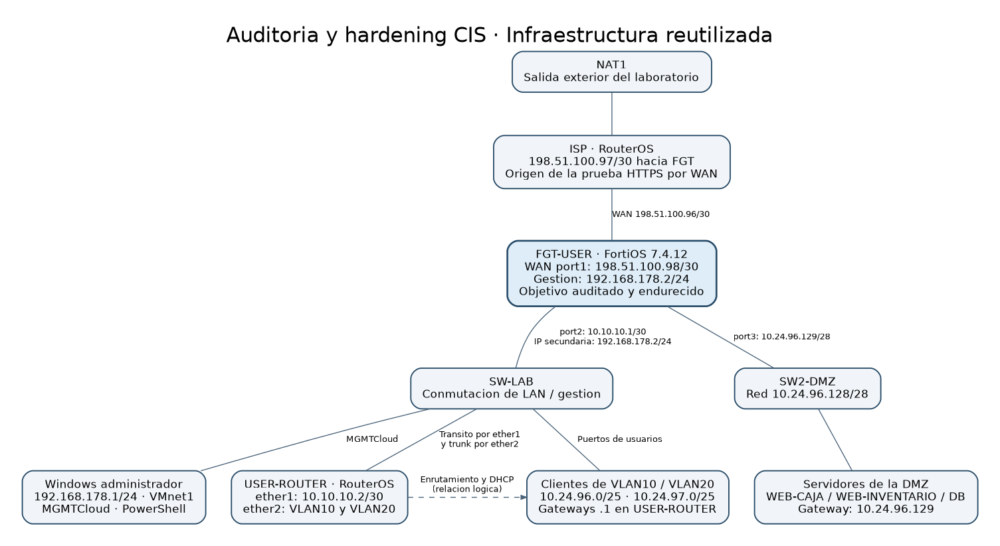
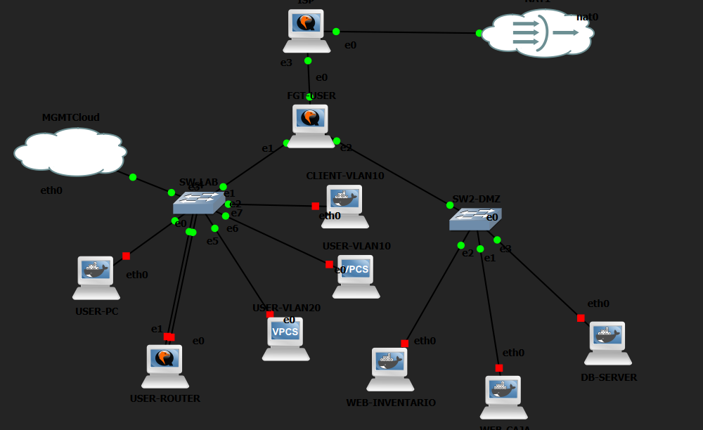
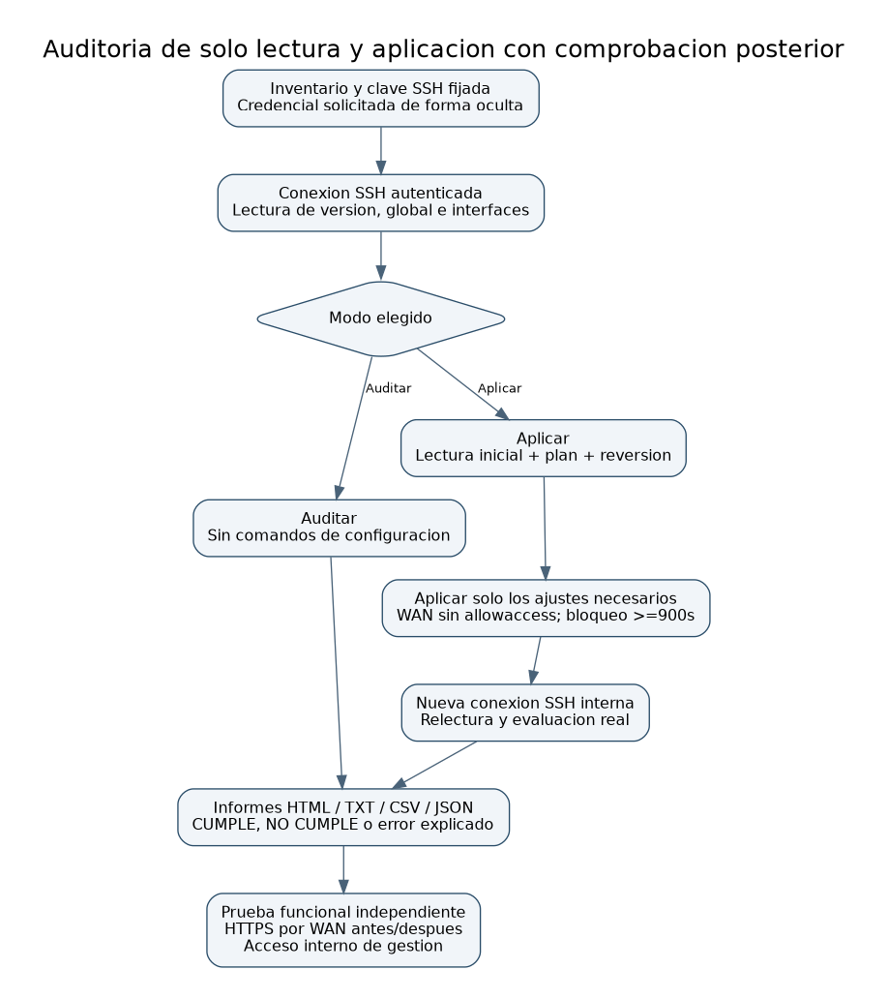
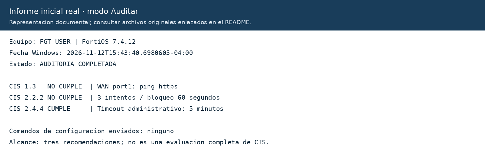
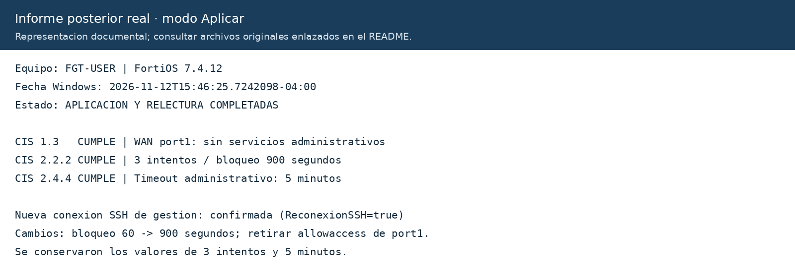
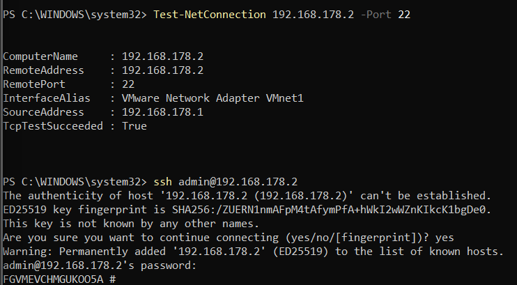
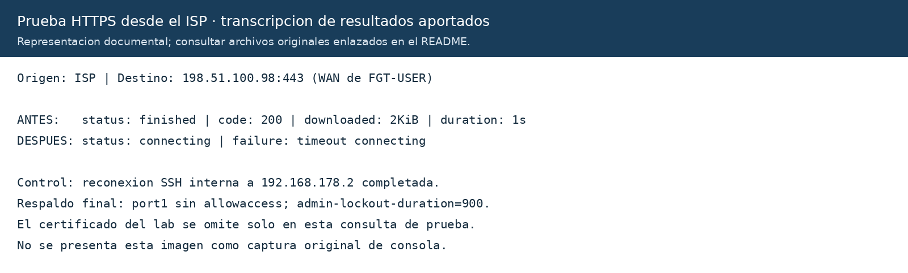

**Video demostrativo en YouTube: PENDIENTE DE PUBLICAR — colocar aquí el enlace real.**

# Auditoría CIS y hardening automatizado de FortiGate

**Autor:** Reymond Guerrero Cruz · **Matrícula:** 2024-0963 · **ITLA**  
**Entorno:** GNS3, FortiGate-VM64-KVM 7.4.12 y PowerShell de Windows.  
**Ejecuciones documentadas:** 12 de noviembre de 2026.

## Propósito y alcance

El propósito es reducir la exposición administrativa del firewall y automatizar la comprobación de recomendaciones de configuración segura. La práctica permite generar un informe sin aplicar cambios y, en un modo separado, aplicar hardening y verificar el estado posterior mediante nuevas lecturas.

La infraestructura reutiliza el proyecto `FortiGate-DMZ-VLAN-Security-Lab`. **FGT-USER es el único objetivo de auditoría y hardening de esta entrega.** ISP aporta el origen externo de prueba y USER-ROUTER conserva el enrutamiento de clientes. Sus configuraciones se incluyen para documentar la infraestructura; no se afirma haberlos auditado con un benchmark de FortiGate.

Se revisan **tres recomendaciones de CIS FortiGate 7.4.x Benchmark v1.0.1, perfil L1**. La herramienta es un desarrollo propio basado en recomendaciones publicadas; no es CIS-CAT ni una certificación de cumplimiento integral. La edición del benchmark se verificó en CIS y los controles concretos se contrastaron con la implementación pública de Tenable y documentación Fortinet. [Fuentes y alcance](docs/fuentes-y-alcance.md).

## Topología



El firewall conecta la WAN del ISP, el tránsito interno y la DMZ. La estación Windows accede por MGMTCloud usando VMnet1. USER-ROUTER enruta las VLANs 10 y 20 hacia el FortiGate por 10.10.10.0/30. El diagrama representa conexiones y configuración; no declara probadas todas las comunicaciones entre clientes y servidores.



| Equipo / interfaz | Dirección o función |
|---|---|
| FGT-USER port1 | 198.51.100.98/30, WAN; administración retirada tras hardening |
| ISP ether7 | 198.51.100.97/30, vecino WAN del firewall |
| ISP ether10 | Cliente DHCP y salida con masquerade, según export |
| FGT-USER port2 | 10.10.10.1/30, tránsito interno |
| USER-ROUTER ether1 | 10.10.10.2/30, default route hacia 10.10.10.1 |
| FGT-USER secundaria de port2 | 192.168.178.2/24, gestión interna |
| Windows VMnet1 | 192.168.178.1/24, estación de auditoría |
| FGT-USER port3 | 10.24.96.129/28, gateway DMZ |
| USER-ROUTER VLAN10-USERS | 10.24.96.1/25; DHCP 10.24.96.10–120 |
| USER-ROUTER VLAN20-ADMIN | 10.24.97.1/25; DHCP 10.24.97.10–120 |

Las etiquetas de puertos GNS3 y los nombres RouterOS se documentan por separado: ISP tiene interfaces renombradas. [Conexiones confirmadas](docs/topologia-y-configuraciones.md).

## Herramienta y modos de ejecución

[Auditar-FortiGate.ps1](scripts/Auditar-FortiGate.ps1) recorre los equipos declarados en [equipos.json](scripts/equipos.json), conecta por SSH con credencial solicitada de forma oculta, fija la clave ED25519 del equipo y consulta la versión y configuración. El inventario de esta ejecución incluye únicamente FGT-USER.

| Modo | Operación | Evidencia obtenida |
|---|---|---|
| Auditar | Solo consultas; sin comandos de configuración | Informe inicial HTML, TXT, CSV y JSON |
| Aplicar | Lectura inicial, plan, cambios necesarios y nueva conexión SSH para releer | Informe antes/después, plan y reversión de parámetros |



La herramienta no cambia la configuración para desactivar la paginación: la atiende en el canal de consola. Un error de lectura, autenticación o formato no se convierte en un resultado de cumplimiento. No se guardan contraseñas en el inventario ni en los informes. [Uso y requisitos](scripts/README.md).

## Auditoría inicial sin cambios

Ejecución real del modo Auditar: **2026-11-12T15:43:40.6980605-04:00**. El JSON registra `ComandosEnviados: []` y estado `AUDITORIA COMPLETADA`.



Originales: [HTML](informes/Auditar-20261112-154340-688/FGT-USER/informe.html) · [TXT](informes/Auditar-20261112-154340-688/FGT-USER/informe.txt) · [CSV](informes/Auditar-20261112-154340-688/FGT-USER/informe.csv) · [JSON](informes/Auditar-20261112-154340-688/FGT-USER/informe.json).

## Recomendaciones, justificación y resultado

| CIS | Justificación | Antes | Acción y estado posterior |
|---|---|---|---|
| **1.3** — Servicios de administración en WAN | Reducir exposición de la administración desde el exterior | `port1: ping https`; no cumple | `unset allowaccess` en port1. Posterior: sin servicios administrativos; cumple |
| **2.2.2** — Intentos y duración del bloqueo | Limitar intentos repetidos de acceso no autorizado | 3 intentos, 60 segundos; no cumple | Duración aumentada a 900 segundos; conserva 3 intentos. Cumple |
| **2.4.4** — Timeout administrativo | Reducir exposición de sesiones desatendidas | 5 minutos; cumple | Se conserva el valor existente de 5 minutos; cumple |

Se aplicaron **dos correcciones** y se conservó una condición que ya cumplía. El criterio de timeout se evalúa entre 1 y 15 minutos; el objetivo elegido al aplicar es como máximo 5. El script conserva los valores ya más estrictos.

Los comandos realmente enviados en esta ejecución fueron:

```text
config system global
set admin-lockout-duration 900
end
config system interface
edit "port1"
unset allowaccess
next
end
```

[Plan original](informes/Aplicar-20261112-154625-715/FGT-USER/plan-aplicacion.conf) · [Reversión de los parámetros afectados](informes/Aplicar-20261112-154625-715/FGT-USER/reversion-parametros.conf). La reversión restaura los valores anteriores y reabriría la administración por WAN; se conserva como evidencia de recuperación, no es un paso de la demostración normal.

## Informe posterior y acceso interno

Ejecución real del modo Aplicar: **2026-11-12T15:46:25.7242098-04:00**. Estado `APLICACION Y RELECTURA COMPLETADAS`; `ReconexionSSH: true`. La nueva conexión de gestión pudo establecerse después de aplicar los cambios y permitió obtener las lecturas posteriores.



Originales: [HTML](informes/Aplicar-20261112-154625-715/FGT-USER/informe.html) · [TXT](informes/Aplicar-20261112-154625-715/FGT-USER/informe.txt) · [CSV](informes/Aplicar-20261112-154625-715/FGT-USER/informe.csv) · [JSON](informes/Aplicar-20261112-154625-715/FGT-USER/informe.json).



## Prueba funcional de administración por WAN

Desde la consola del **ISP**, conectado al lado WAN, se ejecutó el mismo comando antes y después:

```routeros
/tool fetch url="https://198.51.100.98/" check-certificate=no output=none duration=10s
```

Antes respondió HTTP **200**, con 2 KiB descargados. Después produjo **timeout connecting**. Esta comparación se acompaña de la retirada de allowaccess en el respaldo final y de la reconexión interna registrada por el script; no se interpreta un timeout aislado como prueba suficiente.



[Transcripción en texto](evidencias/prueba-wan-transcripcion.txt). La consulta omite la validación del certificado del laboratorio solo para esa prueba y no envía credenciales. No modifica la configuración HTTPS del firewall.

## Qué se probó

| Verificación | Evidencia y límite |
|---|---|
| Modo sin aplicar reglas | Informe inicial con lista vacía de comandos de configuración |
| Aplicación automatizada | Plan original y registro de los ocho comandos enviados |
| Validación posterior | Nueva sesión SSH y tres resultados de cumplimiento por relectura |
| Administración externa | Consulta HTTPS desde ISP: HTTP 200 antes y timeout después |
| Gestión interna disponible | Reconexión SSH posterior registrada en el informe |
| Bloqueo y timeout | Valores comprobados en configuración. No se provocó un bloqueo con contraseñas erróneas ni se cronometró una sesión inactiva |

Los resultados se limitan al firewall y los controles elegidos. No se afirma cobertura completa del benchmark, auditoría de MikroTik, validación nueva de VPN, firmas IPS, políticas web, DHCP o todas las VLANs.

## Configuraciones y archivos del repositorio

- [FortiGate final enmascarado](configs/FGT-USER-final-enmascarado.conf): backup nativo aportado; secretos sustituidos por FortinetPasswordMask.
- [ISP.rsc](configs/ISP.rsc) y [USER-ROUTER.rsc](configs/USER-ROUTER.rsc): exports de la infraestructura de apoyo.
- [Alcance de configuraciones](configs/README.md): diferencias entre backup enmascarado, export y estado por defecto.
- [Scripts y uso](scripts/README.md): herramienta, preparación de Windows e inventario.
- [Informes originales](informes/): archivos reales generados por ambos modos.
- [Diagramas](diagramas/): PNG, SVG, fuente DOT y generador.
- [Procedencia e integridad](evidencias/procedencia.md): origen de las evidencias y hash del script.
- [Guion de demostración](docs/guion-video.md): recorrido de aproximadamente 7–9 minutos.
- [Publicación y entrega](docs/publicar-y-entregar.md): repositorio propio, video y TXT de enlaces.


